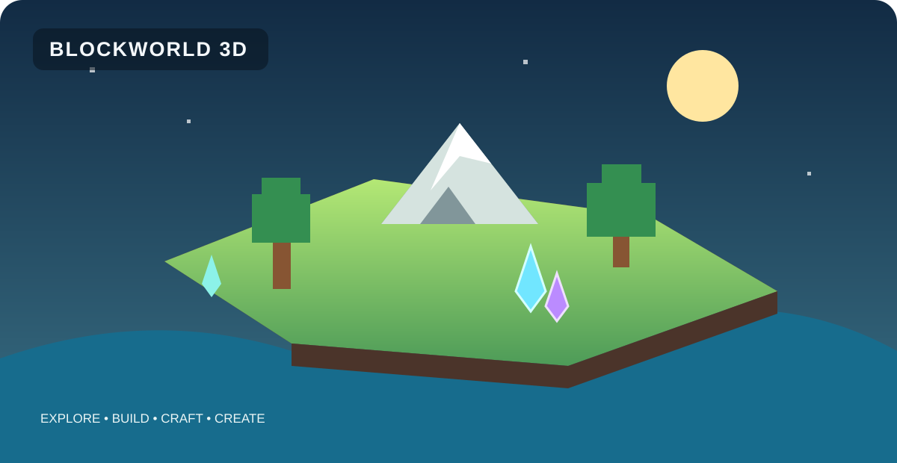

# BLOCKWORLD 3D — Unofficial Voxel Sandbox Fan Project

<p align="center">
  
</p>

<p align="center">
  <a href="https://github.com/drishch69-byte/BLOCKWORLD-3D/releases"></a>
  <a href="https://github.com/drishch69-byte/BLOCKWORLD-3D/actions/workflows/linux-macos-package.yml"></a>
  <a href="https://github.com/drishch69-byte/BLOCKWORLD-3D/actions/workflows/java-ci.yml"></a>
</p>

<p align="center">
  <b>Explore · Build · Craft · Create your world</b><br>
  <a href="https://github.com/drishch69-byte/BLOCKWORLD-3D/releases">All platform downloads</a> ·
  <a href="https://github.com/drishch69-byte/BLOCKWORLD-3D/blob/main/docs/PLAYER_GUIDE.md">Player guide</a> ·
  <a href="PROMOTE.md">Share the project</a>
</p>

**An unofficial, independently developed 3D voxel sandbox fan project built with Java 17 and jMonkeyEngine 3.9.0. Current development version: 1.9.18 — Launcher Backup Update.**

Explore a block-based world, gather resources, build structures, discover creatures, farm crops, craft equipment, trade with villagers, fish, and unlock achievements.

**Project website:** the multilingual site source is in [docs/index.html](docs/index.html), with a separate [version history](docs/versions.html) covering updates from 1.1.0 to 1.9.18. To publish it, open **Settings → Pages**, select **GitHub Actions** as the build and deployment source, and save. The included workflow then deploys the site on updates to `main` at [drishch69-byte.github.io/BLOCKWORLD-3D](https://drishch69-byte.github.io/BLOCKWORLD-3D/).

**Want to help?** Share [the project](https://github.com/drishch69-byte/BLOCKWORLD-3D), try a build, [report a bug](https://github.com/drishch69-byte/BLOCKWORLD-3D/issues/new/choose), or suggest a feature.

> Minecraft 3D is an unofficial, independent voxel sandbox fan project. It is not affiliated with or endorsed by Mojang or Microsoft. It does not include Minecraft source code, textures, sounds, models, or other official assets. All game code and original assets in this repository are independently created.

## Current version

**1.9.18 — Launcher Backup Update (development)**

- The launcher now lets you create a manual backup from the selected world's backup window.
- Backups include the world save and companion progress files for the player, achievements, pets, and animals.
- Press **F5** to refresh the saved-world list without restarting the launcher.
- The home screen now displays the current launcher release notes and the latest game highlights.

**Previous: 1.9.17 — Melee Combat Update**

- **ЛКМ** наносит удар мобам, если они находятся перед игроком и ничто не закрывает цель.
- В мультиплеере ЛКМ позволяет ударить другого игрока рядом; сервер проверяет дистанцию, направление и броню.
- Удары гостя по мобам передаются хосту, который сохраняет авторитетное состояние существ.
- Если перед игроком нет цели, ЛКМ продолжает добывать блоки; атака через стены не проходит.

**Previous: 1.9.16 — Lantern Lighting**

- Lanterns cast a warm glow on nearby block surfaces, fading over a radius of about **7 blocks**.
- Placing or mining a lantern refreshes nearby visible chunk meshes.
- Lighting works with PNG texture packs and the fallback color renderer; world save format remains **2**.

**Previous: 1.9.15 — Farmstead Decorations**

- Wooden fences use connected 3D posts and rails instead of solid cubes.
- Craft a lantern with **2 copper ingots + 1 torch** and a scarecrow with **4 planks + 2 sticks + 1 wheat**.
- Press **Y** to cycle through fence, feeder, gate, lantern and scarecrow; press **G** to place the selected building.
- Lanterns and scarecrows have their own 3D models and return to the inventory when mined.
- New blocks are saved with the existing world format **2**.

**Previous: 1.9.14 — Gates & Smarter Animal Pens**

- Aim at a gate and press **F** to open or close it. The open gate swings to the side and no longer blocks the doorway.
- Gate state is saved directly in the world file without changing world format 2.
- Farm animals turn away sooner when they reach a fence.
- **Y** cycles between fence, feeder and gate; **G** places the selected building.
- Gate toggling and feeder stock management remain single-player only until their multiplayer interactions are synchronized.

**Previous: 1.9.13 — Farm Pens & Smart Feeders**

- Craft wooden fence blocks and use them to build animal pens.
- Craft a feeder, place it with **G**, then aim at it and press **F** to load wheat and wheat seeds.
- Feeders store up to 64 wheat and 64 seeds; cows, sheep and pigs eat wheat, while chickens and chicks eat seeds.
- Nearby animals are fed automatically, one matching portion every 45 seconds.
- Feeding speeds up baby growth and helps animals recover from breeding or product cooldowns.
- Press **Y** to switch the selected building between fence and feeder. Breaking a feeder returns its remaining feed.
- Feeder stock is saved with animal progression in the existing sidecar and kept in world backups; world save format remains 2.
- Feeder placement and stock management are single-player only until multiplayer feeder state is synchronized.

**Previous: 1.9.12 — Farm Products & Harvest**

- Press **U** near a cow with an empty bucket to collect a milk bucket; cows need 90 seconds before producing milk again.
- Press **U** near a sheep with shears to collect two wool; wool regrows in three minutes.
- Chickens lay one egg every 75 seconds; press **U** nearby to collect it. Press **E** to drink milk, restore 6 hunger and get the empty bucket back.
- Press **F** near two adult animals of the same species to breed them; product collection has its own key and does not conflict with breeding.
- Added original 16×16 PNG inventory icons for empty buckets, shears, milk buckets, wool and eggs.
- Added crafting recipes for empty buckets and reusable shears; animal product timers are saved and included in backups.
- Farm-product collection is single-player only until animal timers and inventory changes are synchronized in multiplayer.
- Kept world save format 2 and earlier profile behavior.

**Previous: 1.9.11 — Farm Life & Baby Animals**

- Breed adult cows, sheep, pigs, and chickens in single-player survival by bringing two of the same species together and pressing **F** while carrying two feed items.
- Cows, sheep, and pigs eat wheat; chickens eat wheat seeds.
- Calves, lambs, piglets, and chicks use smaller models and grow into adults after three minutes of active game time.
- Each parent has a five-minute breeding cooldown; baby growth and cooldowns are stored in a separate animal sidecar and included in world backups.
- Nearby farm animals provide a small extra wheat-growth bonus.
- Kept world save format 2 and all earlier creature IDs unchanged.

**Previous: 1.9.10 — Fox Companions & Taming**

- Feed a nearby fox cooked fish and press **F** to tame it in survival mode.
- Tamed foxes follow you; press **N** near a dog or tamed fox to switch between **Follow** and **Stay**.
- Fox taming is saved beside the world without changing world save format 2; older profiles and old saves remain supported.
- Multiplayer fox taming is disabled until companion-state synchronization is implemented.

**Previous: 1.9.9 — Enchanted Grove & Artifact Collection**

- Added the rare **Enchanted Grove** surface biome with mossy ground, denser trees, glow crystals and ferns.
- Added deterministic 1.9.9 biome sampling and a saved `enchantedBiomes` flag; 1.9.8 worlds keep their previous biome map.
- Added artifact collection achievements for the Ancient Relic, Sun Sigil, Moon Sigil and completing the full set.
- The two temple caches guarantee opposite sigils by temple side, making the collection completable in one world.
- Added an eight-biome exploration target for 1.9.9 while retaining the older five- and seven-biome targets.
- Kept world save format 2 and existing block, creature and item IDs unchanged.

**Previous: 1.9.8 — Ancient Temples & Relics**

- Added two remote **Ancient Temples** built from sandstone, rune pillars and open arena courtyards.
- Added two **Temple Wardens**, each with a dedicated blocky model, 95 health and hostile movement around its temple.
- Added **Ancient Caches** with separate deterministic rewards: one Ancient Relic, one Sun or Moon Sigil, emeralds and metal ingots.
- Added three collectible inventory artifacts with original 16×16 PNG icons: **Ancient Relic**, **Sun Sigil** and **Moon Sigil**.
- Temple structures, wardens and relic caches are generated only in new 1.9.8 worlds; older 1.9.7 worlds remain unchanged.
- Kept world save format 2 and appended stable block, creature and item IDs.

**Previous: 1.9.7 — Crystal Guardians & Hidden Treasures**

- Added crystal trees, Crystal Caches and the Crystal Sentinel to newly generated 1.9.7 worlds.
- Added a separate, seed-stable reward table for Crystal Caches and retained ordinary chest rewards.

**Previous: 1.9.6 — Cave Biomes & Glowflora**

- Added Crystal Grotto, Moss Cavern and Underground Lake biomes with their own plants and luminous crystal blocks.
- Added cave-biome labels to the HUD and optional caveBiomes metadata while preserving world format 2.

**Previous: 1.9.5 — Crystal Caverns & Gem Veins**

- Added larger underground caverns with crystal-lined walls and small underground pools.
- Added rare **ruby ore** and **sapphire ore** veins in deep stone layers.
- Added original 16×16 pixel-art textures for both gems to the built-in Default resource pack and resource-pack template.
- Ruby and sapphire deposits require an iron-tier pickaxe; the gem veins use stable new block IDs.
- New cave generation is exclusive to the 1.9.5 profile; earlier profiles keep their original terrain generation.
- World save format remains 2, and old saves continue to load.

**Previous: 1.9.4 — Mining Feedback Update**

- Hold the **left mouse button** to mine in survival mode; releasing it or changing the target cancels progress.
- A live mining progress indicator appears below the crosshair.
- Harder blocks take longer to mine, and a suitable tool speeds up matching blocks.
- Creative mode keeps instant breaking, and creature interactions remain available.
- World and player save formats are unchanged.

**Previous: 1.9.3 — Inventory Tabs Update**

- The survival inventory is split into **Resources** and **Equipment** tabs.
- Press **1** or **2** to switch tabs; left/right arrows cycle between them.
- The number keys no longer change the hotbar while the inventory is open.
- Existing item icons, player portrait, and save formats remain unchanged.

**Previous: 1.9.2 — Classic Hotbar Controls**

- Mouse-wheel cycling through quick-access block slots, with number keys 1–9 retained.
- Wheel selection is paused while menus and modal game screens are open.

**Previous: 1.9.1 — World Creator & Seeds**

- Create a new world with a name, selected size (small, normal, or large), and optional numeric seed.
- Empty seed values create a random world; explicit seeds make terrain generation repeatable.
- The chosen world radius is saved with the world so custom dimensions survive reloads.
- Older worlds without the optional radius field continue using their original version defaults.

**Previous: 1.9.0 — Living World & Companions**

- Press **N** near a dog companion to switch between **Follow** and **Stay** commands.
- Companion commands are saved in a separate pets.properties sidecar; the world file format and creature IDs remain unchanged.
- Pet sidecars are included in world backups and restores.
- Existing worlds without a pet sidecar continue to load with dogs following the player by default.
- Includes all 1.8.1 wildlife and 1.8.0 village, flower, farming, and creature features.

**Earlier: 1.8.1 — Rabbit & Wildlife**

- Rabbits with a dedicated 16×16 PNG texture, blocky model, ears, tail, and a small hopping animation.
- Rabbits spawn in suitable plains, forest, taiga, and snowy-tundra habitats.
- Rabbit creature IDs use the existing world-creature save format, so older worlds remain readable.

**Earlier: 1.8.0 — Village Defense & Combat**

- Zombies, skeletons and spiders; iron golem and villager guard protect village residents.
- Farmer, blacksmith, librarian and guard villager professions.
- Fifteen named flowers, tall and short grass, and ferns in seeded meadows.
- Rain and nearby farmers boost wheat growth; the LAN server validates close-range player interactions.

**Earlier: 1.2.0 — Exploration Update**

- Seven surface biomes: plains, forests, deserts, snowy tundra, mountains, taiga, and swamps (the two new biomes appear in the 1.1.0 profile).
- Chunk-based voxel world, mining, and building.
- Nine creature types, including foxes, turtles, and a dog companion that follows the player.
- Crystal caves, mineshafts, watchtowers, ruins, camps, lootable treasure chests, and an on-screen compass map (B).
- Inventory, crafting, tools, and iron armor.
- Farming, wheat, furnaces, smelting, and cooked food.
- Fishing, copper and emerald ores, and achievements.
- Settings, mods, and PNG resource packs.
- Separate persistence files for world and player progression data.

## Windows download

A portable **Windows x64** preview build is included in the [Cross-platform Portable Builds workflow](https://github.com/drishch69-byte/BLOCKWORLD-3D/actions/workflows/linux-macos-package.yml). For permanent versioned downloads, use the [GitHub Releases page](https://github.com/drishch69-byte/BLOCKWORLD-3D/releases). The separate [Windows Portable Build workflow](https://github.com/drishch69-byte/BLOCKWORLD-3D/actions/workflows/windows-package.yml) can also be started manually.

- Open the cross-platform workflow page and select the latest successful run on `main`.
- Download the **windows-package** artifact from the run's Artifacts section.
- Extract the ZIP and run `BLOCKWORLD 3D.exe` from the extracted `BLOCKWORLD 3D` folder.
- The package includes its Java runtime; Java and Maven do not need to be installed.
- Keep the extracted folder intact. Worlds and settings are stored separately in `%USERPROFILE%\\.blockworld3d`.

Pushing a matching version tag such as `v1.9.18` starts the cross-platform release workflow. It waits for all four builds and attaches Windows, Linux, macOS Apple silicon and macOS Intel archives to one permanent GitHub Release.

## Linux and macOS downloads

Preview builds for Linux and both macOS processor families are created by the [Cross-platform Portable Builds workflow](https://github.com/drishch69-byte/BLOCKWORLD-3D/actions/workflows/linux-macos-package.yml). Versioned releases for all four desktop targets are published together on the [GitHub Releases page](https://github.com/drishch69-byte/BLOCKWORLD-3D/releases).

Open the workflow page, choose the latest successful run on `main`, then download the matching artifact:

- **Linux x64 — `linux-package`:** extract the `.tar.gz`, open the `BLOCKWORLD 3D` folder, and run `./run-game.sh`.
- **macOS Apple silicon — `macos-arm64-package`:** for M-series Macs.
- **macOS Intel — `macos-x64-package`:** for Intel-based Macs.

For either macOS build, extract the ZIP and open `BLOCKWORLD 3D.app` (or move it to Applications). Each package includes its own Java runtime, so Java and Maven do not need to be installed. Keep the complete Linux app folder or macOS `.app` bundle intact.

The macOS app images are not signed or notarized by Apple and may display a first-launch security notice. Only download builds from this official repository. Linux needs a desktop environment and compatible graphics drivers/OpenGL support.

Preview workflow artifacts are retained for 30 days. GitHub Release assets remain attached to their versioned release until that release is deleted. A version tag must match the version in both `game/pom.xml` and `game/VERSION.txt`; release publication runs only after all four platform packages have succeeded.

## Download

- **Permanent versioned builds:** [GitHub Releases](https://github.com/drishch69-byte/BLOCKWORLD-3D/releases) — choose one of the four platform archives attached to a release.
- **Latest source code:** [Download source ZIP](https://github.com/drishch69-byte/BLOCKWORLD-3D/archive/refs/heads/main.zip).

[**Download latest source ZIP (1.9.18 development)**](https://github.com/drishch69-byte/BLOCKWORLD-3D/archive/refs/heads/main.zip)

The complete source project is available in [game/](game/), including Java sources, JUnit tests, sound resources, example resource packs, and an example mod. The GitHub repository URL and legacy save-data folder remain unchanged for compatibility. The older [1.0.0 snapshot ZIP](BLOCKWORLD_3D_1.0.0_TRADING_FISHING_ACHIEVEMENTS_UPDATE.zip) is retained as a previous snapshot.

## Build and test

Requirements:
- JDK 17
- Apache Maven
- A desktop graphics environment supporting the OpenGL features required by jMonkeyEngine

From the source folder:

```bash
cd game
mvn clean verify
```

The GitHub Actions Java CI workflow runs the same Maven verification on pushes and pull requests that change the game source. The current source build is verified by the Java 17 CI workflow; the job compiles the project, runs JUnit tests, and packages the application.

Launch scripts are provided for Windows (run.bat) and Linux/macOS (run.sh).

## Project documentation

- [Multilingual project website](docs/index.html) — English, Ukrainian and Russian landing page.
- [Version history](docs/versions.html) — changelog and feature summaries from 1.1.0 through 1.9.18.
- [Promotion kit](PROMOTE.md) — ready-to-share descriptions and official project links.
- [Player guide](docs/PLAYER_GUIDE.md) — controls, survival loop, and save reminders.
- [Roadmap](ROADMAP.md) — proposed features for versions 1.1.0 through 2.0.0.
- [Contributing](CONTRIBUTING.md) — development and testing guidelines.
- [Security policy](SECURITY.md) — especially important when using Java mods.

## Technology

- Java 17
- jMonkeyEngine 3.9.0
- Maven

## Contributing

Bug reports, ideas, and improvement suggestions are welcome. Use the GitHub issue templates when opening an issue. Pull requests are checked by the Java 17 Maven workflow.

**Explore. Build. Craft. Create your world.**
